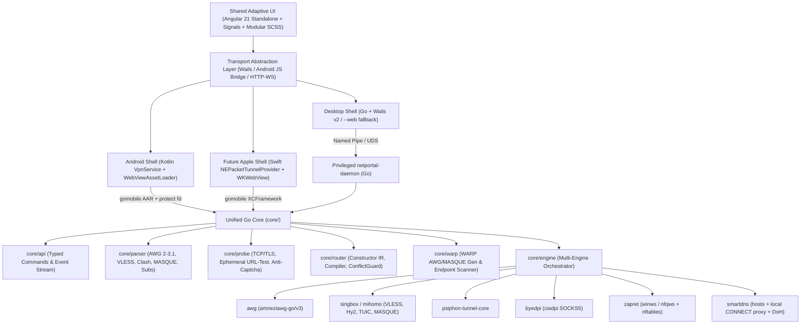

# Архитектура NetPortal

Документ описывает системную архитектуру **NetPortal** — монорепозитория с единым сетевым Go-ядром, модульным адаптивным веб-интерфейсом на Angular 21 и тонкими платформенными оболочками для Desktop и Android (с готовностью к macOS и iOS).

---

## 1. Общая структурная схема



---

## 2. Структура монорепозитория

```text
NetPortal/
├── AGENTS.md                 # Базовые правила разработки и контракты границ
├── GEMINI.md / CLAUDE.md / .cursorrules
├── .agents/skills/           # Проектные скиллы для AI-агентов
├── go.work                   # Go workspace (./core, ./desktop)
├── core/                     # Единое платформонезависимое Go-ядро
│   ├── api/                  # DTO, RPC-методы, события (единый контракт UI <-> Core)
│   ├── engine/               # Реализации движков + ConflictGuard + Orchestrator
│   ├── mobile/               # Экспортируемый фасад под gomobile bind (без сложных структур)
│   ├── parser/               # Импортеры и сериализаторы подписок и конфигов
│   ├── probe/                # Пре-коннект пингер и детектор антибот-заглушек
│   ├── router/               # Промежуточное представление (IR) конструктора и компиляция
│   ├── storage/              # Персистентное хранилище профилей, нод, списков и истории пинга
│   ├── warp/                 # Регистрация/генерация WARP + сканер чистых IP/эндпоинтов
│   └── cmd/netportal-daemon/ # Десктопный демон (Win Service, Linux systemd / pkexec-session)
├── ui/                       # Единый модульный Web UI (Angular 21 Standalone + TS + SCSS)
├── desktop/                  # Тонкая Desktop-оболочка (Win + Linux + macOS)
├── android/                  # Тонкая Kotlin-оболочка (VpnService + WebView + jniLibs)
├── ios/                      # Резерв под NEPacketTunnelProvider + WKWebView
└── docs/                     # VISION.md, ARCHITECTURE.md, ROADMAP.md, DESIGN_SYSTEM.md, adr/
```

Жесткие границы зависимостей:
- `core/` **не зависит** от `desktop/`, `Wails`, `GTK`, `WebView` или UI-пакетов.
- `core/mobile/` экспортирует только `gomobile`-совместимые примитивы (`string`, `[]byte`, `int64`, `bool`, `error`, простые callback-интерфейсы для `ProtectFD` и стрима событий). Сложные структуры передаются как JSON согласно схемам `core/api`.
- `ui/` общается с бэкендом строго через единый интерфейс `Transport`, который подменяет реализацию в зависимости от среды запуска (`WailsTransport`, `AndroidBridgeTransport`, `HttpWsTransport` для `--web`).

---

## 3. Multi-Engine ядро (`core/engine/`)

Нет единого upstream-ядра, которое одинаково хорошо покрывает AWG 3.1, MASQUE RFC 9484, Psiphon, ByeDPI, Zapret и zero-RAM `hosts`. Поэтому `core/engine` реализует слой оркестрации поверх специализированных движков:

| Движок | Базовая технология | Что обслуживает | Работа без прав админа |
| :--- | :--- | :--- | :--- |
| **`awg`** | `github.com/amnezia-vpn/amneziawg-go/v3` | WireGuard, AmneziaWG 2.0, 3.0 (`HeaderProtectionKey`, `ContentPaddingAddition`, `Rekey*`, `Reject*`, диапазоны `H1-H4` / `PersistentKeepalive`), 3.1 (`RandomTrailers`, `DisableCookies`) | На Android через `VpnService`; на Desktop через системный демон (TUN) |
| **`singbox`** | `sing-box` (+ патч/адаптер под `mihomo`/MASQUE при необходимости) | VLESS (Reality, Vision, XHTTP), VMess, Trojan, Hysteria2, TUIC, Shadowsocks, SOCKS5, HTTP, MASQUE (RFC 9484 CONNECT-IP), маршрутизация внутри TUN и локальный mixed inbound | Режим локального/системного прокси — без админки; TUN — через демон / Android `VpnService` |
| **`psiphon`** | `github.com/Psiphon-Labs/psiphon-tunnel-core` | Подключение к сети Psiphon с выбором региона, локальный SOCKS5 для прямого режима или цепочки (`outbound -> psiphon`) | Полностью без админки (и в TUN на Android/Desktop как hop) |
| **`byedpi`** | `ciadpi` (`libciadpi.so` / встроенный бинарник) | User-space TCP DPI-десинхронизация (split, disorder, fake, TLS record split) поверх локального SOCKS5 | Полностью без админки и без root (в т.ч. внутри Android `VpnService`) |
| **`zapret`** | `winws` (Windows WinDivert) / `nfqws` + `nftables` (Linux) | Ядерный DPI-обход + QUIC UDP 443 desync для YouTube + автоподбор стратегий | Требует демон (`WinDivert` / `NFQUEUE`), только Desktop |
| **`smartdns`** | Нативный Go-модуль (`core/engine/smartdns`) | Атомарное управление `hosts` (Zero-RAM), локальный HTTP CONNECT прокси (`127.0.0.1`), DoH-проверка + антибот-фильтрация | Local proxy — без админки; `hosts` — через демон; на Android — через локальный DNS внутри TUN |

### Схема взаимодействия движков при сложном профиле
Когда пользователь в **Конструкторе маршрутизации** смешивает несколько технологий (например, часть доменов через `ByeDPI`, часть приложений через `VLESS DE`, часть через `WARP AWG 3.1`), главный маршрутизирующий TUN (на базе `sing-box` tun/netstack) выступает единым перехватчиком пакетов, а отдельные движки (`awg`, `psiphon`, `byedpi`, `masque`) подключаются к нему как локальные outbound-адаптеры (SOCKS5 / local pipe / netstack dialer). Если же запущен только один чистый туннель `AWG 3.1` без сложных правил, ядро может поднимать его напрямую на `amneziawg-go/v3` без лишнего промежуточного слоя.

---

## 4. Единая доменная модель (`core/api` и `core/router`)

Чтобы UI, парсеры, пробер и движки говорили на одном языке, вводятся 5 базовых сущностей:

1. **`Source` (Источник конфигурации):**
   - Подписка по URL, локальный файл (`.conf`, YAML, JSON), вставленный текст или встроенный генератор (`WARP`, `Psiphon`).
   - Хранит статус последнего обновления, количество нод, лимиты трафика/дату истечения (если присланы заголовки `Subscription-Userinfo`).
2. **`Node` (Сервер / Конечная точка):**
   - Иммутабельный идентификатор, имя, тег протокола (`awg2`, `awg3`, `awg31`, `wg`, `vless`, `hy2`, `tuic`, `masque`, `psiphon`, `warp`, `socks`, `byedpi`), адрес/порт, регион и нормализованный конфиг.
   - Хранит результаты последних замеров пинга отдельно от состояния подключения (`tcpMs`, `urlTestMs`, `antiBotStatus`, `checkedAt`).
3. **`OutboundGroup` (Группа выбора / Резервирования):**
   - `selector` — ручной выбор пользователя (без неожиданной смены).
   - `urltest` — автовыбор наименьшей задержки.
   - `sticky_fallback` — **закрепленный основной сервер с кросс-протокольным резервом**:
     - `members: string[]` (упорядоченный список ID нод любых протоколов);
     - `healthcheck: { url, intervalSec, timeoutSec, failThreshold }`;
     - `stickBackOnRecovery: bool` + `recoveryCooldownSec: int` (защита от частого переключения туда-обратно).
4. **`RoutingProfile` (Профиль конструктора маршрутизации):**
   - При создании имеет **пустой список правил (`rules: []`)** и явную цель `defaultTarget` — **никаких скрытых правил по умолчанию**.
   - Упорядоченный список `Rule`:
     - `enabled`, `name`;
     - `match`: `domains`, `domainSuffixes`, `domainKeywords`, `domainRegexes`, `externalLists`, `ipCidrs`, `ipPools` (`start-end`), `ports`, `network`, `processNames`, `processPaths`, `androidPackages`;
     - `target`: `direct` | `block` | `node:<id>` | `group:<id>` | `byedpi:<presetId>` | `dns:<resolverId>`.
5. **`StandaloneMode` и `ConflictReport`:**
   - Независимый запуск `Zapret`, `Smart Hosts`, `Local Proxy` или `ByeDPI` в 1 клик без TUN.
   - `ConflictGuard` перед стартом проверяет совместимость с активным TUN, системными VPN-интерфейсами (`tun*`, `wg*`, `amnezia*`, `tailscale*`), `HTTP_PROXY` и файлом `hosts`, формируя явный список предупреждений/блокировок и действий по разрешению.

---

## 5. Пре-коннект инвентарь и двухуровневый пробер (`core/probe/`)

Решает ключевой недостаток Hiddify:
1. **Импорт и хранение независимо от туннеля:** Парсинг подписки/файла немедленно сохраняет все ноды в `core/storage`. Пользователь сразу видит все серверы, протоколы, поля AWG 3.0/3.1 и может выбрать нужную ноду до старта VPN.
2. **Уровень 1 — Быстрый пинг (`FastProbe`):** Параллельная проверка TCP/TLS-хэндшейка (для UDP-протоколов вроде AWG/Hy2 — доступность эндпоинта/ICMP или контрольный хэндшейк-пакет где возможно). Позволяет просканировать 100+ серверов за ~1 секунду.
3. **Уровень 2 — Реальная задержка без TUN (`RealDelayProbe`):** Для выбранных пользователем или всех нод поднимается эфемерный in-memory dialer нужного движка (без создания системного сетевого интерфейса и без изменения маршрутов ОС), через него выполняется `HTTP GET/HEAD generate_204` и опциональная проверка на капчи Cloudflare/Google (эвристика детекции Cloudflare Turnstile / Google Sorry), после чего dialer сразу закрывается.

---

## 6. Процессы, привилегии и специфика ОС

### 6.1. Windows
- **Режим службы (NSIS Installer):** При установке один раз регистрируется Windows Service `NetPortalService`. Пользовательский UI (`desktop`) запускается без прав администратора и общается с сервисом по Named Pipe `\\.\pipe\netportal-daemon` с ACL только на SYSTEM / Administrators / владельца сессии. В повседневной работе UAC не появляется вообще.
- **Portable-режим (`.exe`):** Стартует без прав администратора. Безрутовые функции (`ByeDPI`, `Psiphon`, системный прокси, генератор WARP, парсинг и пинг нод) работают сразу. При включении TUN, `WinDivert`/`winws` или `hosts` один раз запрашивается UAC на запуск фоновой сессии `netportal-daemon` на время жизни приложения.

### 6.2. Linux (Wayland / X11)
- **`.deb` пакет (рекомендуемый способ):**
  - В `DEBIAN/control` указывается `Depends: libgtk-3-0 | libgtk-3-0t64, libwebkit2gtk-4.1-0, libayatana-appindicator3-1, ca-certificates` (совместимость со свежими `.deb`-дистрибутивами, где удален `webkit2gtk-4.0` и переименована GTK3 в `t64`).
  - Скрипт `postinst` устанавливает `netportal-daemon.service` (systemd), политику Polkit и бинарники `nfqws`/`ciadpi` в `/usr/lib/netportal/` с правами `0755`. После установки пользователь не вводит пароль и не прописывает права вручную.
- **Portable `.tar.gz`:**
  - Встроенные бинарники при первом старте автоматически распаковываются в `~/.local/share/netportal/bin/` с программной установкой `os.Chmod(..., 0755)`.
  - Для рутовых операций (TUN, `nfqws` + `nftables`, `/etc/hosts`) запускается единая привилегированная сессия `pkexec netportal-daemon session` — максимум один запрос пароля за сеанс.
  - Файлы `rules.nft` генерируются строго в UTF-8 **без BOM** с идемпотентным началом `add table inet netportal` + `flush table inet netportal`.
- **Защита GUI от багов Wayland + WebKit2GTK 4.1:**
  - Сборка с `-tags webkit2_41`.
  - В `desktop/main.go` до инициализации окна программно выставляется `WEBKIT_DISABLE_DMABUF_RENDERER=1` (устраняет пустые окна и `Error 71` на Wayland/NVIDIA).
  - В CSS объявлены `<meta name="color-scheme" content="dark light">` и `appearance: none` для `<select>`/`<input>` (устраняет белые GTK-поля на темной теме).
  - Резервный флаг `--web`: открывает тот же локальный UI в системном браузере (с одноразовым Bearer-токеном и строгим биндингом на `127.0.0.1`).

### 6.3. Android (без root)
- Тонкий Kotlin-shell (`VpnService`, `WebViewAssetLoader`, Quick Settings Tile) загружает собранный `ui/dist` локально и связывается через JS-мост с `netportal-core.aar` (из `core/mobile` через `gomobile bind`).
- Нативный `ciadpi` собирается через Android NDK в `libciadpi.so` внутри `jniLibs/<abi>/` — Android сам распаковывает его с правом на исполнение, никаких `chmod` от пользователя.
- Все сокеты исходящего трафика внутри Go-ядра и `ciadpi` защищаются через `VpnService.protect(fd)` (через переданный из Kotlin callback / локальный protect-сокет), исключая петлю маршрутизации внутри TUN.
- Выбор приложений в Конструкторе маршрутизации опирается на `PackageManager` + `VpnService.Builder.addAllowedApplication` / `addDisallowedApplication` (либо перехват всего трафика с маршрутизацией по UID/сопоставлением правил внутри ядра).
